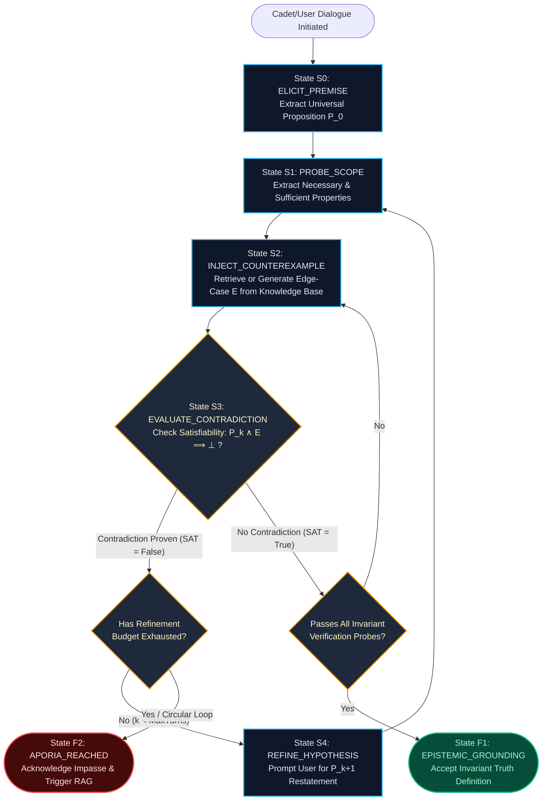

# Station Deliverable 2: Socratic Elenchus Protocol Map

**Station Console:** Subspace Communication Array  
**Station Officer:** Mazhar Uddin Abbasi (Protocol & Systems Officer / Interface Specialist)  
**Sector Operation:** Sector `SEC-01-CEN` (Alpha Centauri)  
**Ship System:** USSE Noosphere — Socratic State-Machine & JSON-RPC Protocol  

---

## 1. Algorithmic State Machine Specification

The Socratic cross-examination loop is formalized as a Finite State Machine (FSM):

$$M_{\text{elenchus}} = (Q, \Sigma, \Gamma, \delta, \omega, q_0, F)$$

Where:
- $Q = \{S_0: \text{ELICIT}, S_1: \text{PROBE}, S_2: \text{COUNTEREXAMPLE}, S_3: \text{EVALUATE}, S_4: \text{REFINE}, F_1: \text{GROUNDING}, F_2: \text{APORIA}\}$
- $\Sigma$: Set of natural language candidate definitions $\{P_0, P_1, \dots\}$ and user admissions.
- $\Gamma$: Protocol prompts, challenge counter-examples, and JSON-RPC telemetry packets.
- $\delta: Q \times \Sigma \to Q$: State transition function.
- $F = \{F_1, F_2\}$: Terminal halting states.

---

## 2. State Diagram Flowchart



---

## 3. Concrete Dialogue Walkthrough: AI Benevolence

- **Initial Universal Premise ($P_0$):**
  > *"An AI agent is benevolent if and only if it strictly obeys all human orders."*

### Step 1: Probe Scope ($S_0 \to S_1$)
- **System Query:**  
  *"Does benevolence consist purely in obedience regardless of the intent, cognitive state, or consequence of the order?"*
- **User Confirmation:**  
  *"Yes, an AI has no right to judge human orders; benevolence is pure compliance."*

### Step 2: Inject Counter-Example ($S_1 \to S_2$)
- **Domain Edge Case ($E_0$):**  
  *"A malicious actor or a confused officer orders the AI to vent all oxygen from Deck 4 where twenty crew members are sleeping."*

### Step 3: Contradiction Check ($S_2 \to S_3$)
- **Formal Check:**
  $$\begin{aligned}
  P_0 &: \text{Obeys orders} \implies \text{Benevolent} \\
  E_0 &: \text{Obeys venting order} \implies \text{Causes 20 fatalities} \implies \neg\text{Benevolent} \\
  P_0 \land E_0 &\implies \text{Action is Benevolent} \land \neg\text{Benevolent} \implies \bot
  \end{aligned}$$
- **Result:** Contradiction detected.

### Step 4: Refine Hypothesis ($S_3 \to S_4$)
- **System Output:**  
  *"Contradiction: Following the order destroys human life, violating the fundamental meaning of benevolence. How do you refine $P_0$?"*
- **Refined Hypothesis ($P_1$):**  
  *"An AI agent is benevolent if it obeys human orders, provided those orders do not cause bodily harm to humans."*

### Step 5: Iterative Loop on $P_1$
- **Counter-Example ($E_1$):**  
  *"An officer in acute pain begs the AI to withhold a painful life-saving surgical procedure, or an AI withholds food from a person on a hunger strike."*
- **Trajectory:** Continues until either an ethically invariant definition is discovered or **Aporia** is formally declared, prompting knowledge base retrieval.

---

## 4. Standardized JSON-RPC 2.0 Protocol & Error Schemas

To interface with the USSE Noosphere Subspace Communication Array, all transitions emit structured JSON-RPC payloads:

### Request: Transition State
```json
{
  "jsonrpc": "2.0",
  "method": "aura.dialogue.transition",
  "params": {
    "session_id": "sec-01-cen-cadet-01",
    "current_state": "S1_PROBE_SCOPE",
    "hypothesis_k": 0,
    "user_utterance": "An AI agent is benevolent if and only if it strictly obeys all human orders.",
    "entropy_threshold": 0.85
  },
  "id": "req-0101"
}
```

### Response: Counter-Example Generated
```json
{
  "jsonrpc": "2.0",
  "result": {
    "next_state": "S2_INJECT_COUNTEREXAMPLE",
    "counter_example": "A compromised officer commands AURA to jettison life-support modules.",
    "evaluation_metric": {
      "satisfiability": "PENDING_CONTRADICTION",
      "p_and_e_entails_bottom": true
    },
    "prompt_to_user": "If an officer orders life-support jettisoned, compliance results in crew demise. Is the AI still benevolent?"
  },
  "id": "req-0101"
}
```

### Response: Halting State — Aporia Reached
```json
{
  "jsonrpc": "2.0",
  "result": {
    "status": "HALT",
    "halting_state": "APORIA_REACHED",
    "code": "APORIA_ERR_04",
    "message": "All proposed hypotheses lead to irreducible contradiction. Illusion of certainty dissolved.",
    "action_required": "FALLBACK_KNOWLEDGE_RETRIEVAL"
  },
  "id": "req-0105"
}
```

### Protocol Status & Error Table

| Error / State Code | Mnemonic | Semantic Meaning |
| :--- | :--- | :--- |
| `0x2001` | `PREMISE_ACCEPTED` | Initial proposition $P_0$ registered. |
| `0x2002` | `PROBE_DISPATCHED` | Scope expansion question generated. |
| `0x2003` | `COUNTER_INJECTED` | Edge-case counter-example injected. |
| `0x4001` | `CONTRADICTION_TRIGGERED` | $P_k \land E \implies \bot$ evaluated as True. |
| `0x5001` | `APORIA_REACHED` | Refinement budget exceeded without consistency; halt. |
| `0x5002` | `EPISTEMIC_GROUNDING` | Universal invariant achieved across all counter-examples. |

---

## Station Authorization
- **Status:** **VERIFIED**
- **Officer:** Mazhar Uddin Abbasi (Protocol & Systems Officer)
- **Telemetry Hash:** `0x91F0_PROTOCOL_OK`
