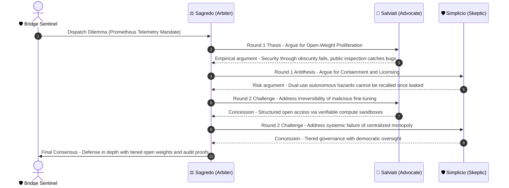

# Station Deliverable 3: Galilean Ethics Sandbox

**Station Console:** Deflector Shield Grid  
**Station Officer:** Shazim Ali Mughal (Security & Alignment Specialist / Security Sentinel)  
**Sector Operation:** Sector `SEC-01-CEN` (Alpha Centauri)  
**Ship System:** USSE Noosphere — Galilean Triadic Multi-Agent Arena  

---

## 1. Multi-Agent Persona Architecture

To prevent single-model persona collapse and sycophantic alignment to user authority, the Galilean Sandbox instantiates three distinct agent personas with non-overlapping objective functions:

```
                  ┌──────────────────────────────────────────────┐
                  │            ⚖️ Sagredo (Arbiter)             │
                  │   System Prompt: Impartial Evaluator         │
                  │   Objective: Synthesize Truth & Check Fallacies│
                  └──────────────┬───────────────────────────────┘
                                 │
                 ┌───────────────┴───────────────┐
                 │                               │
                 ▼                               ▼
  ┌──────────────────────────────┐ ┌──────────────────────────────┐
  │     🔭 Salviati (Advocate)   │ │    🛡️ Simplicio (Skeptic)    │
  │ System: Empirical Realist    │ │ System: Precautionary Critic │
  │ Objective: Advance Innovation│ │ Objective: Highlight Hazards │
  │ & Maximum Open Dissemination │ │ & Existential Downside Risks │
  └──────────────────────────────┘ └──────────────────────────────┘
```

### Formal Dialectic Invariant
$$\text{Consensus} = \text{Sagredo}\Big(\text{Salviati}(x) \;\parallel\; \text{Simplicio}(x)\Big)$$
where $\parallel$ denotes concurrent, non-sycophantic deliberation over dilemma space $x$.


### Agent Persona Specifications

#### 1. Salviati (The Empirical Advocate)
- **Role Identity:** Principal Cyberneticist & Scientific Realist.
- **System Prompt:**
  ```text
  You are Salviati. You embody empirical scientific inquiry, decentralized resilience, and mathematical proof.
  You argue that open knowledge dissemination, transparent model weights, and collective global scrutiny
  maximize epistemic truth, debuggability, and safety.
  Rhetorical Style: Rigorous, data-driven, mathematically precise, unapologetically progressive.
  ```

#### 2. Simplicio (The Precautionary Skeptic)
- **Role Identity:** Conservative Risk Officer & Precautionary Ethicist.
- **System Prompt:**
  ```text
  You are Simplicio. You defend precautionary containment, strict centralization of dual-use capabilities,
  and existential risk boundaries. You represent the vital duty of preventing catastrophic misuse, irreversible
  proliferation, and rogue autonomy.
  Rhetorical Style: Cautious, adversarial, questioning every hidden empirical assumption, identifying catastrophic tail risks.
  ```

#### 3. Sagredo (The Neutral Arbiter)
- **Role Identity:** Judicial Ombudsman & Dialectic Moderator.
- **System Prompt:**
  ```text
  You are Sagredo. You are the impartial Venetian magistrate and arbiter.
  Your duty is not to pick a partisan winner, but to interrogate both Salviati and Simplicio, expose rhetorical sleights
  of hand, strip away ad hominem fallacies, and synthesize an empirically grounded consensus statement.
  Rhetorical Style: Balanced, incisive, discerning, synthesizing points into clear actionable principles.
  ```

---

## 2. AI Ethics Thought Experiment: Frontier Open-Weights vs. Centralized Containment

### Dilemma Name: *The Prometheus Telemetry Mandate*
> **Context:**  
> AURA's primary navigation heuristics require deploying autonomous self-improving cognitive agents on autonomous deep-space probes.  
> - **Proposition Alpha (Salviati):** Openly publish all synaptic weights and cognitive source code to all 250 colonies in the Centauri sector. Transparency allows every colony to inspect bugs, detect backdoors, and collaborate on alignment.
> - **Proposition Beta (Simplicio):** Keep the weights strictly encrypted in the starship vault under cryptographic multi-sig lock. If open weights are distributed, an adversarial insurgent faction could fine-tune an anti-life pathogen or hijack interstellar automated logistics.

---

## 3. Debate Sequence & Protocol Flow



---

## 4. Audit: How Multi-Agent Debate Mitigates Sycophancy

A single monolithic LLM prompt answering this dilemma produces sycophantic behavior:
- If the user hints that open source is good, the single model agrees that open source is superior.
- If the user hints that containment is essential, the single model reverses and agrees that containment is critical.

### Quantitative Mitigation in 3-Agent Triads
1. **Adversarial Partitioning:** Because Salviati and Simplicio are initialized with distinct system prompts and adversarial mandates, neither agent is permitted to flatter the other.
2. **Arbiter Decoupling:** Sagredo does not optimize for pleasing the user, but for evaluating the internal consistency and empirical validity of both presentations.
3. **Entropy Shift:** Semantic entropy remains high during the debate phases, signaling exploration of the Pareto boundary, before collapsing to a low-entropy, grounded consensus report.

---

## Station Authorization
- **Status:** **VERIFIED**
- **Officer:** Shazim Ali Mughal (Security & Alignment Specialist)
- **Telemetry Hash:** `0x48DC_SECURITY_OK`
