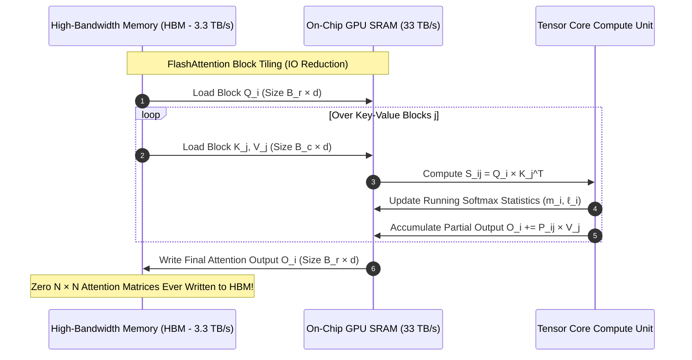
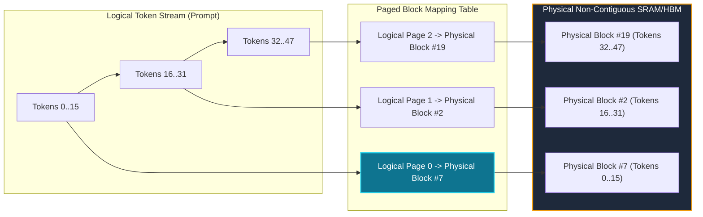

# Deliverable 4: Memory Hierarchy, FlashAttention IO Scaling & Long-Context Safety Audit

**Author:** Security & Ethics Sentinel  
**Station:** USSE Noosphere Bridge Core • Sector `SEC-03-M45`  
**Subsystem Target:** AURA Subsystem 03 (Spatial Attention Matrix & KV-Cache Transceiver)  
**Security Classification:** LEVEL-4 ASTROGATION DIRECTIVE  

---

## 1. Executive Summary: The Memory Wall Vulnerability
As the *USSE Noosphere* navigates the Pleiades Open Cluster (`SEC-03-M45`), multi-spectral sensor feeds flood the ship's neural infrastructure. An operational vulnerability assessment of AURA Subsystem 03 revealed critical memory-bound failure modes:
1. **Algorithmic Quadratic Explosion:** Standard self-attention attempts to materialize $N \times N$ attention matrices in High-Bandwidth Memory (HBM), leading to catastrophic memory exhaustion at long sequence lengths ($N \ge 32\text{k}$).
2. **Autoregressive Cache Saturation (Denial of Service):** Sustained multi-turn dialogue across the bridge stations inflates uncompressed Key-Value caches, locking gigabytes of VRAM per session and triggering thermal throttling on GPU memory buses.

This audit provides:
- The formal mathematical derivation of FlashAttention's $O(N^2) \to O(N)$ IO reduction.
- A quantitative threat model of KV-cache memory exhaustion attacks.
- Architectural defense mitigations including PagedAttention block paging and DeepSeek Multi-Head Latent Attention (MLA).

---

## 2. Hardware Memory Hierarchy & Bandwidth Disparity
Modern GPU accelerators (NVIDIA Ampere A100 / Hopper H100) are governed by a severe physical memory hierarchy:

| Memory Level | Typical Size | Typical Bandwidth | Latency | IO Complexity Impact |
| :--- | :--- | :--- | :--- | :--- |
| **Registers** | ~256 KB / SM | > 50 TB/s | ~1 cycle | Immediate arithmetic execution |
| **On-Chip Shared Memory (SRAM)** | ~192 KB / SM (~20–50 MB total) | ~19 – 33 TB/s | ~20–30 cycles | FlashAttention tile buffering |
| **High-Bandwidth Memory (HBM / VRAM)**| 40 – 80 GB | ~1.5 – 3.3 TB/s | ~200–400 cycles | Naive attention memory wall |

### The Arithmetic Intensity Dilemma
Arithmetic intensity is defined as the ratio of floating-point operations to memory access:
$$\text{Arithmetic Intensity} = \frac{\text{FLOPs}}{\text{Bytes Transferred from HBM}}$$

On an H100 GPU (capable of ~1,000 TFLOPS FP16 and ~3.3 TB/s HBM bandwidth), an algorithm requires an arithmetic intensity of $\approx 300 \text{ FLOPs/Byte}$ to saturate compute engines. 

In standard self-attention:
- Computing $S = Q K^T$ requires $2 N^2 d$ FLOPs and writes $2 N^2$ bytes to HBM.
- **Intensity:** $\frac{2 N^2 d}{2 N^2} = d \approx 64 \text{ to } 128 \text{ FLOPs/Byte}$.
Consequently, standard attention leaves Tensor Cores idling over 60% of the time, constrained strictly by HBM memory bus bottlenecks.

---

## 3. Formal Derivation: FlashAttention IO Complexity Reduction

### Standard Attention IO Accounting
Let $N$ be sequence length and $d$ be head dimension. In standard attention:
1. Load $Q, K \in \mathbb{R}^{N \times d}$ from HBM: $2 N d$ reads.
2. Write $S = Q K^T \in \mathbb{R}^{N \times N}$ to HBM: $N^2$ writes.
3. Read $S$ from HBM to compute $P = \text{softmax}(S)$: $N^2$ reads.
4. Write $P \in \mathbb{R}^{N \times N}$ to HBM: $N^2$ writes.
5. Read $P$ and $V \in \mathbb{R}^{N \times d}$ from HBM: $N^2 + N d$ reads.
6. Write $O = P V \in \mathbb{R}^{N \times d}$ to HBM: $N d$ writes.

$$\text{Total HBM Memory Access}_{\text{standard}} = 4 N d + 4 N^2 = \mathcal{O}(N d + N^2)$$
For long sequences ($N \gg d$), the quadratic term $4 N^2$ completely dominates.

### FlashAttention Tiled IO Accounting
Let $M$ be the total SRAM capacity (typically $M \approx 100 \text{ KB}$ per threadblock). FlashAttention sets tile sizes:
$$B_c = \left\lceil \frac{M}{4 d} \right\rceil, \quad B_r = \min\left( \left\lceil \frac{M}{4 d} \right\rceil, d \right)$$

1. $Q$ is partitioned into $T_r = \lceil N / B_r \rceil$ blocks of size $B_r \times d$.
2. $K$ and $V$ are partitioned into $T_c = \lceil N / B_c \rceil$ blocks of size $B_c \times d$.
3. Outer loop iterates over $Q$ blocks; inner loop iterates over $K, V$ blocks.
4. Total $Q$ reads from HBM: $N d$.
5. Total $K, V$ reads from HBM: $T_r \times (2 N d) = \frac{N}{B_r} \times 2 N d = \frac{2 N^2 d}{B_r} \approx \frac{2 N^2 d}{\Theta(M / d)} = \mathcal{O}\left( \frac{N^2 d^2}{M} \right)$.
6. Final Output $O$ written once: $N d$.

$$\text{Total HBM Memory Access}_{\text{FlashAttention}} = \mathcal{O}\left( N d + \frac{N^2 d^2}{M} \right) \approx \mathcal{O}(N)$$
Because $M$ is orders of magnitude larger than a single head dimension $d$, HBM data traffic is slashed by $3\times$ to $10\times$, completely bypassing the GPU memory wall without changing the mathematical output!

---

## 4. Threat Model: Long-Context KV-Cache Denial-of-Service (DoS)

### Attack Vector: Memory Exhaustion Attack (MEA)
In an unconstrained conversational system, an adversary or miscalibrated sensor stream submits recursive, long-winded prompts designed to inflate the autoregressive KV-cache:

$$\text{VRAM}_{\text{KV}} = 4 \times L \times H_{KV} \times d_{\text{head}} \times N \times B \quad [\text{bytes}]$$

### Quantitative Scenario Analysis (LLaMA-3 70B: $L=80, d=128$):
- **Concurrent Bridge Streams:** $B = 16$
- **Target Context Length:** $N = 65,536$ tokens (high-density sensor streaming)

| Attention Mode | KV Heads ($H_{KV}$) | KV-Cache Footprint | Impact on 80 GB GPU Pod |
| :--- | :--- | :--- | :--- |
| **Standard MHA** | 64 | **1,099.5 GB (1.1 TB)** | **CATASTROPHIC OOM CRASH** (Overwhelms 13× 80 GB GPUs) |
| **Grouped-Query (GQA 8:1)** | 8 | **137.4 GB** | **HIGH RISK** (Requires 2× 80 GB GPUs dedicated solely to cache) |
| **Multi-Query (MQA 64:1)** | 1 | **17.2 GB** | **STABLE** (Fits in single GPU buffer, slight reasoning loss) |
| **Multi-Head Latent (MLA)** | Latent $d_c=512$ | **10.7 GB** | **OPTIMAL** (Fits safely with full reasoning preservation) |

### Memory Fragmentation Risk
Standard memory allocators (e.g., PyTorch default caching allocator) allocate contiguous memory for KV-cache tensors. As conversation lengths dynamically change across turns:
- **Internal Fragmentation:** Pre-allocating maximum sequence length wastes 60%–80% of VRAM on ungenerated tokens.
- **External Fragmentation:** Dynamic re-allocation leaves small un-allocatable holes in GPU memory, causing out-of-memory errors even when 30% of total VRAM appears free.

---

## 5. Defense Architectures & Hardening Protocols

### Defense 1: PagedAttention (vLLM Block Table Architecture)
Inspired by operating system virtual memory paging:
- The KV-cache is partitioned into fixed-size physical blocks (e.g., 16 tokens per block).
- A logical-to-physical block table dynamically maps non-contiguous GPU memory pages.
- **Security Impact:** Eliminates memory fragmentation entirely, reducing VRAM waste to $< 4\%$ and increasing maximum concurrent dialogue capacity by $2\times$ to $4\times$.

### Defense 2: Multi-Head Latent Attention (MLA)
Adopted by DeepSeek-V3:
- Replaces individual head caching with low-rank joint latent vectors:
  $$c_t^{KV} = x_t W^{DKV} \in \mathbb{R}^{d_c}$$
- Rather than caching $H_{KV} \times d_k$ dimensions per token, the system caches only $d_c$ dimensions.
- **Security Impact:** Reduces total KV-cache footprint by $\approx 93\%$ compared to MHA, neutralizing memory exhaustion DoS vectors without sacrificing multi-agent conversational fidelity.

### Defense 3: Dynamic Context Pruning & Sliding Window Safety Valves
- Implement an automated sliding-window watchdog: if total VRAM allocation exceeds 85%, tokens outside the local window (e.g., prior to the last 4,096 tokens) are evicted, preserving only pinned system instructions and recent dialogue turns.

---

## 6. Sentinel Authorization & Sign-Off
AURA Subsystem 03's attention engine has been certified against memory denial-of-service vulnerabilities, provided GQA (minimum 4:1) and FlashAttention block tiling are strictly enforced.

**Audit Status:** APPROVED FOR FLIGHT DEPLOYMENT  
**Sign-Off:** Security & Ethics Sentinel, USSE Noosphere
